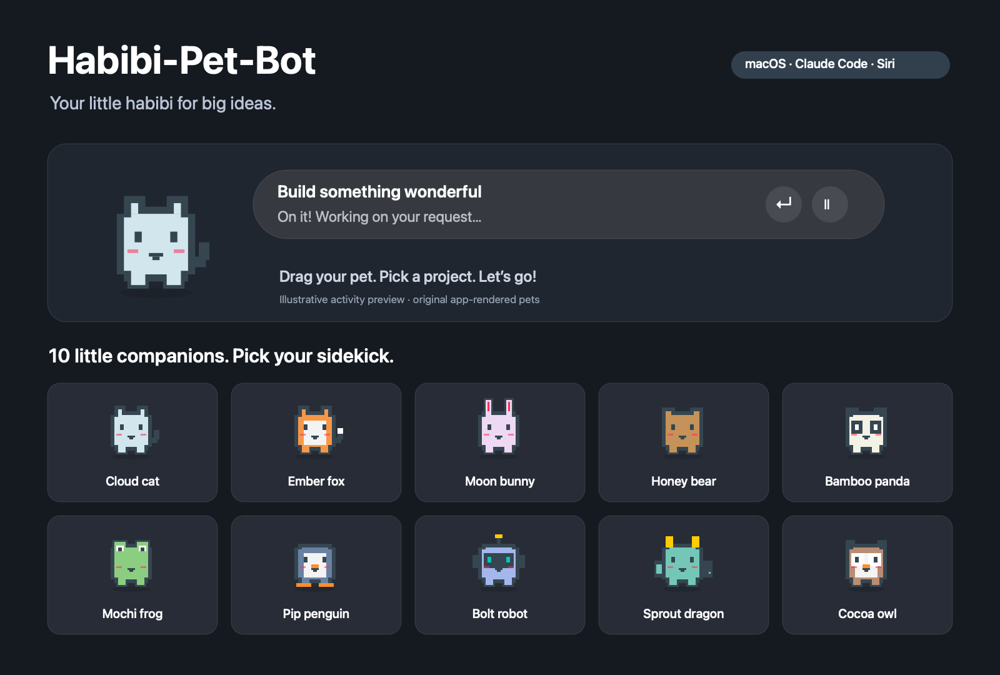
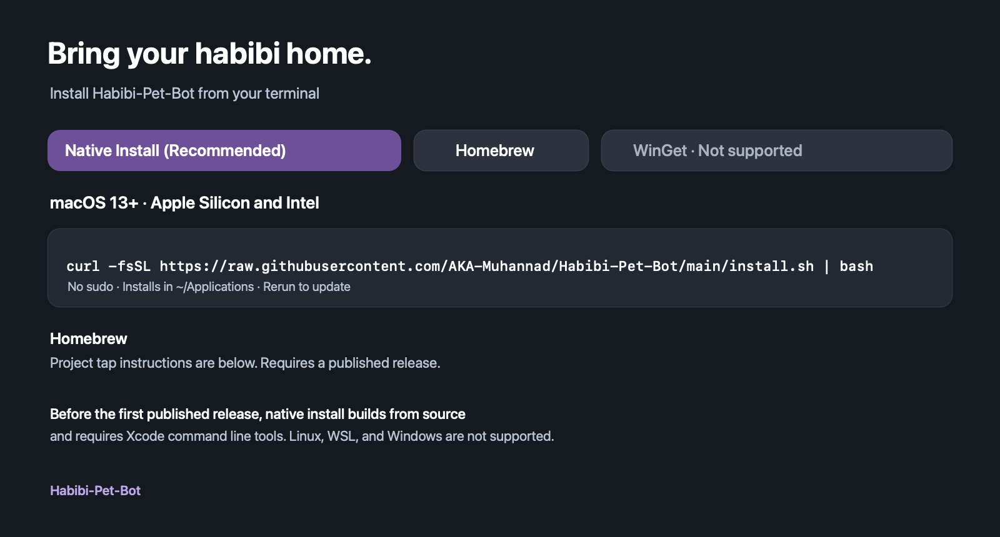

# Habibi-Pet-Bot 🐾

Your little habibi for big ideas. A native macOS desktop pet for Claude Code and Apple Intelligence.



[Download releases](https://github.com/AKA-Muhannad/Habibi-Pet-Bot/releases) · [Installation guide](docs/INSTALL.md) · [Release guide](docs/RELEASING.md)

## Meet your sidekick

- **10 pixel pets:** Cloud cat, Ember fox, Moon bunny, Honey bear, Bamboo panda, Mochi frog, Pip penguin, Bolt robot, Sprout dragon, and Cocoa owl.
- **A floating companion:** drag it around, take it across Spaces, and choose a new friend from the gallery.
- **Claude Code activity:** a compact pill shows your task, tool use, approval requests, and completion for sessions opened through the pet.
- **Pick your project:** choose a folder each time you launch Claude Code; your last location is remembered.
- **Apple Intelligence:** open Siri or run a named shortcut you create in Apple's Shortcuts app.
- **Manual update checks:** the paw menu checks this repository's latest published stable release when you ask.

No API keys, third-party runtime dependencies, or analytics. Uses native AppKit and respects Reduce Motion.

## Install



**macOS 13+ only · Apple Silicon and Intel**

### Native install (recommended)

```sh
curl -fsSL https://raw.githubusercontent.com/AKA-Muhannad/Habibi-Pet-Bot/main/install.sh | bash
```

Installs into `~/Applications` and opens your pet. No sudo or Homebrew required. Quit the pet and rerun the same command to update; your preferences are kept and the previous app is moved to Trash.

Published releases are downloaded and checked against their SHA-256 manifest and app signature. **Until the first release is published**, the installer builds from source, which requires Xcode command line tools (`xcode-select --install`). Release notes describe whether a binary is Apple-notarized. The installer preserves macOS security settings.

### Homebrew

```sh
brew tap aka-muhannad/habibi-pet-bot https://github.com/AKA-Muhannad/Habibi-Pet-Bot.git
brew install --cask aka-muhannad/habibi-pet-bot/habibi-pet-bot
```

Requires a **published release** containing `Habibi-Pet-Bot-universal.zip`. This is a project-maintained tap, not an official Homebrew cask. To update its latest-version cask:

```sh
brew update
brew reinstall --cask aka-muhannad/habibi-pet-bot/habibi-pet-bot
```

### Download manually

Open [Releases](https://github.com/AKA-Muhannad/Habibi-Pet-Bot/releases), download and extract the universal ZIP, then move `Habibi-Pet-Bot.app` to Applications. The included `Install.command` can install into your personal Applications folder. See the [installation guide](docs/INSTALL.md).

**Linux / WSL / Windows / WinGet:** not supported. Habibi-Pet-Bot uses macOS AppKit; this installer does not make it cross-platform.

Claude Code must be installed and authenticated separately. Apple Intelligence needs compatible hardware, macOS, and enabled Apple settings.

## Use

| Control | What it does |
| --- | --- |
| Click the pet | Show or hide activity |
| Drag the pet | Move your sidekick |
| Right-click or menu-bar paw | Settings, update checks, and quit |
| Terminal button | Choose a folder and start Claude Code |
| Sparkles button | Open Siri |
| Paw button | Preview and choose from 10 pets |
| Eye button | Hide/show the pet; a small floating restore button stays visible |
| Activity return arrow | Open the assistant's app |
| Activity pause button | Pause popup updates; the assistant keeps running |

For a custom Apple Intelligence shortcut, create **Ask for Input → Use Model → Show Result** in Shortcuts and save its exact name through the pet menu. [Apple's guide](https://support.apple.com/guide/shortcuts-mac/use-apple-intelligence-in-shortcuts-mchl91750563/mac) describes supported models and requirements.

Claude Code uses your existing installation and account. The pet launches an interactive `claude` session with session-scoped activity hooks. Existing sessions are not connected. Siri does not expose a live activity feed to the pet. [Claude Code CLI reference](https://code.claude.com/docs/en/cli-reference).

## Update

Choose **Check for updates…** in the paw menu. If a newer version is available, open its download page, quit the old pet, and replace the app using the ZIP or installer. Or quit the pet and rerun the native install command; Homebrew users can run the reinstall command above. Your preferences stay saved. Updates are manual; nothing installs in the background.

## Build from source

Install Xcode command line tools, then:

```sh
git clone https://github.com/AKA-Muhannad/Habibi-Pet-Bot.git
cd Habibi-Pet-Bot
zsh build.sh
open dist/Habibi-Pet-Bot.app
```

Builds a universal app for Apple Silicon and Intel. Local builds use ad-hoc signing. To test or create an installable ZIP:

```sh
python3 -m unittest discover -s tests -v
zsh scripts/package.sh
```

Output: `dist/Habibi-Pet-Bot-1.0.0-universal.zip` and `dist/SHA256SUMS.txt` (version follows `VERSION`).

## Publish a new version

Update `VERSION`, the changelog, and release notes; commit; then push a matching `v1.0.1` tag. GitHub Actions builds, tests, and prepares a **draft** release with the ZIP and checksums. Review signing status and assets before publishing. See [RELEASING.md](docs/RELEASING.md) for notarization and full instructions.

## Privacy and limits

Task event labels, tool names, and the first 100 characters of the current prompt are stored in a private temporary directory for the activity pill. Tool arguments and assistant responses are not retained. Only the most recently launched Claude session is displayed. Settings remain local. Update checks contact GitHub only when requested. See [SECURITY.md](SECURITY.md).

Independent project; not affiliated with OpenAI, Anthropic, or Apple. Original pixel artwork. [MIT license](LICENSE).
